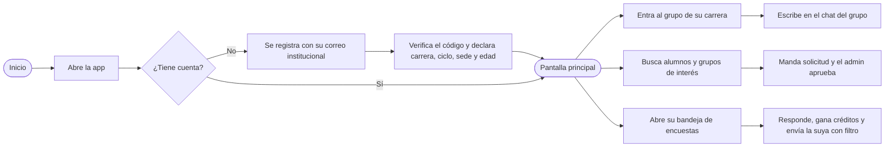

# KAMPUS — Contexto completo del proyecto

> **Qué es este archivo.** Todo lo que hay que saber de Kampus para diseñar y construir el prototipo: el problema, el usuario, las reglas de producto, las pantallas, el modelo de datos y la dirección visual. Está escrito para cargarse como contexto en Google Antigravity y para generar pantallas en Google Stitch.
>
> **Versión:** 1.0 · **Estado:** pre-MVP, prototipo
> **Dueño de producto:** Jorge Valderrama
> **Universidad piloto:** UTP (Universidad Tecnológica del Perú), una sola sede de Lima

---

## 0. Instrucciones para el agente

Si estás leyendo esto como contexto de un proyecto:

1. **No inventes funcionalidades.** Si algo no está en este archivo, pregunta antes de agregarlo. Hay decisiones que ya se discutieron y se descartaron a propósito (sección 5.3).
2. **Respeta las reglas de negocio de la sección 6.** No son preferencias estéticas: son el producto. Sobre todo el mínimo de 30 personas por segmento y el sistema de créditos.
3. **Todo el texto de interfaz va en español peruano**, neutro y corto. Nada de "¡Hola! 👋 Bienvenido a tu nueva experiencia social".
4. **Los datos de ejemplo son ficticios.** Nombres inventados, pero carreras y sedes reales de la UTP.
5. **No reproduzcas el logotipo ni la identidad gráfica oficial de la UTP.** La app es white-label: el color y el nombre de la universidad son variables. Usa "UTP" solo como texto en los datos de ejemplo.
6. **Dos superficies:** app móvil para el alumno (Android, mobile first) y panel web para la universidad y los administradores. No son la misma interfaz.

---

## 1. Kampus en una frase

**Kampus es una red social cerrada por universidad, donde solo entra quien tiene correo institucional y todos usan su nombre real, para que los alumnos se encuentren entre carreras y para que cualquiera pueda mandar una encuesta a un segmento exacto de su universidad.**

No es un chat más. El valor está en que al otro lado hay un alumno real, verificado, con carrera y ciclo conocidos.

---

## 2. El problema

### 2.1 Qué pasa hoy

Un alumno de Ingeniería de la UTP no tiene forma de encontrar a alguien de Psicología o de Derecho dentro de su propia universidad.

- Los grupos de WhatsApp son por salón, y el salón cambia cada ciclo. El grupo muere.
- Los grupos de Facebook de la universidad son abiertos, anónimos y llenos de gente que no estudia ahí.
- Outlook, Teams y Discord existen, pero nadie los usa para conocer gente: son herramientas de clase o de gaming.
- La universidad tampoco tiene cómo preguntarle algo a un grupo específico de alumnos, ni cómo saber si un curso está funcionando.

Resultado: la red de contactos de un alumno es su salón, y nada más.

### 2.2 Dolores concretos que resuelve Kampus

| Dolor | Quién lo sufre | Cómo lo resuelve Kampus |
|---|---|---|
| No conozco a nadie fuera de mi salón | Alumno de cualquier ciclo | Grupos de interés abiertos a toda la universidad + buscador de personas por carrera, ciclo e interés |
| Necesito 50 encuestados de una carrera específica y no los consigo | Tesistas, alumnos de cursos de investigación, profesores | Encuestas con filtro por carrera, ciclo, sede y edad |
| Necesito llegar a un grupo cerrado que no es el mío | Tesistas, organizadores de eventos | Solicitud de publicación: mandas un mensaje y el admin del grupo decide si se publica |
| Mis becas y convocatorias no llegan a quien deben | Oficinas de la universidad | Tablón de eventos con difusión segmentada por carrera, ciclo o interés |
| No sé cómo se sienten mis alumnos con un curso | Decanatos, bienestar | Métricas agregadas y anónimas, con umbral mínimo |

### 2.3 Evidencia (todo verificable, úsalo en el producto con cuidado)

- **1.2 millones** de universitarios en el Perú.
- **103 a 105** universidades licenciadas de unas 143 (49 públicas, 92 privadas).
- **UTP:** 146,829 alumnos de pregrado a nivel nacional, 96,364 en Lima, 15 campus (5 en Lima) → aproximadamente **19,300 alumnos por sede**.
- Facultades UTP: Ingeniería 68,101 · Administración y Negocios 36,537 · Derecho 34,794 · Comunicación 4,672 · Salud 2,525.
- **6%** de peruanos usa LinkedIn frente a **89%** que usa WhatsApp (Ipsos).
- **95.4%** de hogares peruanos con smartphone (Osiptel).
- **27%** de universitarios deserta en el primer año; **48%** no termina la carrera.
- Referencia internacional: **Fizz** llegó al 95% de los 7,600 alumnos de Stanford con el mismo principio de red cerrada por campus (pero anónima y sin filtro).

**Lo que esto implica para el diseño:** la densidad importa más que el tamaño. 19,300 alumnos en un solo campus es suficiente. La app debe sentirse llena desde el primer día (ver sección 6.6).

---

## 3. A quién le sirve

### 3.1 Los tres perfiles del MVP

| Perfil | Qué quiere | Pantalla donde vive |
|---|---|---|
| **El alumno común** | Conocer gente, enterarse de lo que pasa, no sentirse solo | Inicio, Explorar, Grupos |
| **El tesista o investigador** | Conseguir encuestados de un perfil exacto | Crear encuesta, Solicitud de publicación |
| **La universidad** | Difundir, retener alumnos, medir el clima | Panel web |

### 3.2 Buyer persona principal

**Ana Quispe**, 20 años, quinto ciclo de Psicología, sede UTP Lima Norte.

- Viaja 50 minutos en micro al campus.
- Pertenece a dos grupos de WhatsApp, los dos de su salón.
- Usa WhatsApp, Instagram y TikTok. No usa LinkedIn.
- Busca con quién hacer trabajos y prácticas fuera de su carrera.
- **Motivaciones:** pertenecer, conocer gente, oportunidades.
- **Frustraciones:** los grupos mueren cada ciclo, el spam, no saber quién está del otro lado.
- **Arquetipo:** conectora pragmática. Organizada, curiosa, extrovertida, práctica.

### 3.3 Point of View que guía el diseño

> Ana, alumna de quinto ciclo, necesita **conocer alumnos verificados de otras carreras** porque los únicos espacios que tiene son por salón y mueren cada ciclo.

---

## 4. El recorrido del alumno



**El flujo que el prototipo debe mostrar sí o sí:**
`registro → datos declarados → grupo de carrera automático → explorar → perfil de otro alumno → solicitud → bandeja de encuestas → crear encuesta con filtro`

---

## 5. Decisiones de producto

### 5.1 Identidad: declarado vs verificado

Este es el concepto más importante del producto y define el modelo de datos.

- El alumno **declara** su carrera, ciclo, sede y fecha de nacimiento al registrarse. Nadie se lo pide a la universidad.
- El correo institucional es la prueba de que es alumno de esa universidad. Nada más.
- **Cada campo del perfil lleva una marca de origen: `declarado` o `verificado`.**
- Cuando la universidad firma el contrato, se cruza su base de datos y los campos pasan a `verificado` sin tocar el producto.
- En la interfaz, un perfil verificado lleva un sello discreto. Un perfil declarado no lleva nada (no se marca como "no verificado": eso estigmatiza al 100% de los usuarios al inicio).

**Por qué importa:** resuelve la paradoja de arranque. No podemos pedirle la base de datos a la universidad antes de venderle el producto, y no podemos venderle el producto sin tener alumnos adentro.

### 5.2 Dos tipos de espacio

| | **Grupos de carrera** | **Grupos de interés** |
|---|---|---|
| Cómo entras | Automático, por tu carrera + ciclo + sede | Te unes tú, o los creas |
| Quién está | Solo tus compañeros de carrera | Cualquier alumno de la universidad |
| Quién los crea | Nadie: los crea el sistema | Cualquier alumno |
| Para qué | Cursos, horarios, profesores, prácticas | Gym, música, tesis, idiomas, startups, videojuegos |
| Se pueden abandonar | No | Sí |

Los grupos de carrera son el piso que hace que la app no esté vacía. Los grupos de interés son el motor del descubrimiento entre carreras.

**Solicitud de publicación:** si necesitas llegar a un grupo cerrado que no es tuyo, no pides entrar. Mandas **un solo mensaje** y el admin del grupo decide si se publica. Así un tesista llega a Psicología sin romper el espacio de Psicología.

### 5.3 Decisiones ya descartadas (no las vuelvas a proponer)

| Se descartó | Por qué |
|---|---|
| Canales por tema dentro de cada grupo (tipo Discord) | Complejidad innecesaria con pocos usuarios. Un grupo = un chat |
| Premiar al que responde encuestas con **acceso a más grupos** | Convierte los grupos en moneda y rompe el sentido del espacio cerrado. Se reemplazó por créditos |
| Anonimato (modelo Fizz) | El valor del producto es justo lo contrario: saber quién está del otro lado |
| Encuestas como link externo (Google Forms) | Se pierde el filtro, los créditos y la tasa de respuesta. La encuesta vive **dentro** de la app |
| Feed algorítmico | No hay volumen para que tenga sentido, y desvía el producto hacia entretenimiento |
| Vender datos personales a la universidad | Ilegal bajo la Ley 29733 y mata la confianza del alumno |

---

## 6. Reglas de negocio que no se negocian

### 6.1 Entrada
- Solo se registra quien tiene un correo institucional válido de una universidad habilitada.
- Verificación por código de 6 dígitos enviado a ese correo.
- Nombre y apellido reales. Sin seudónimos.
- Foto opcional.

### 6.2 Mensajes directos
- No hay mensaje directo libre. Se manda una **solicitud**; hasta que la otra persona acepta, no se puede escribir.
- Dentro de un grupo al que perteneces, el chat es libre.

### 6.3 Encuestas con filtro
- El emisor arma un filtro con: universidad, sede, carrera, ciclo (rango), edad (rango) e intereses.
- La app muestra **en vivo** cuántos alumnos caen en ese filtro.
- **Si el segmento tiene menos de 30 personas, el envío se bloquea.** Es la garantía de anonimato y es un límite duro, no una advertencia.
- La encuesta llega a una **bandeja dentro de la app**, no a un link externo.
- El emisor nunca ve quién respondió qué. Ve respuestas agregadas.

### 6.4 Créditos
- Respondes una encuesta: **+1 crédito**.
- Envías una encuesta: **−1 crédito por cada persona que la recibe**.
- Todo alumno arranca con un saldo inicial (sugerido: 20) para que el sistema pueda empezar a moverse.
- Tope: cada alumno recibe como máximo **2 a 3 encuestas por semana**. Si el tope está lleno, el envío se encola, no se descarta.
- El saldo y el historial son visibles para el alumno.

### 6.5 Moderación
- Botón de reportar en cada mensaje, perfil y grupo.
- Bloquear a un usuario.
- Los grupos de interés tienen admin (quien lo creó); los de carrera tienen moderador asignado.
- **La universidad no modera el contenido ni ve los mensajes.** Esto va por escrito en el contrato. Solo ve métricas agregadas.

### 6.6 Arranque (importa para el diseño)
- Al lanzar, los grupos de carrera ya deben existir y tener gente.
- Ninguna pantalla debe verse vacía en el primer uso. Cada estado vacío necesita un diseño propio con una acción clara ("todavía no hay mensajes aquí — sé el primero en escribir").

### 6.7 Legal (Perú)
- Ley 29733 de Protección de Datos Personales y su reglamento DS 016-2024-JUS. Multas de hasta aproximadamente S/550,000.
- **Consentimientos separados por finalidad**, no una casilla única: (a) crear la cuenta, (b) recibir encuestas de otros alumnos, (c) que la universidad vea métricas agregadas. Cada uno se puede revocar.
- Datos mínimos: no se pide DNI, dirección, ni teléfono.
- Mayores de 18 años. La fecha de nacimiento se usa para el filtro de edad y para confirmar la mayoría de edad.

---

## 7. Alcance del MVP

### Dentro
- Registro con correo institucional y perfil declarado
- Grupo de carrera automático por carrera, ciclo y sede
- Grupos de interés abiertos, creados por alumnos
- Chat grupal
- Buscador de alumnos y de grupos con filtros
- Mensaje directo con solicitud
- Encuestas con filtro, bandeja de encuestas y créditos
- Solicitud de publicación con aprobación del admin
- Tablón de eventos de la universidad
- Reportar y bloquear
- Panel web básico para la universidad

### Fuera (por ahora)
- Canales por tema dentro de los grupos
- Llamadas de voz y video
- Feed algorítmico
- Marketplace o pagos
- Opiniones de cursos (v1.1 — decisión sensible, ver 5.3)
- Grupo de egresados (v2)
- Verificación cruzada con la base de datos de la universidad (llega cuando firma el contrato)

---

## 8. Mapa de pantallas — App móvil

Navegación inferior de 5 ítems: **Inicio · Explorar · Grupos · Encuestas · Perfil**

### 8.1 Registro e identidad

| # | Pantalla | Contenido |
|---|---|---|
| M01 | **Bienvenida** | Logo, una línea de propuesta de valor, botón "Entrar con mi correo institucional", link "¿Qué es Kampus?" |
| M02 | **Correo institucional** | Campo de correo, selector de universidad (solo las habilitadas), validación en vivo del dominio, mensaje de error claro si el dominio no está habilitado |
| M03 | **Código de verificación** | 6 casillas, reenviar código con contador de 60 segundos, cambiar correo |
| M04 | **Tus datos** | Nombre y apellido, fecha de nacimiento (date picker), carrera (buscador con las carreras de esa universidad), ciclo (1 a 10), sede (lista). Texto corto bajo cada campo explicando para qué sirve |
| M05 | **Intereses y habilidades** | Chips seleccionables de intereses (mínimo 3). Dos campos de habilidades: "sé hacer" y "busco" |
| M06 | **Permisos** | Tres consentimientos **separados**, cada uno con su switch y su explicación de una línea. Botón "Crear mi cuenta" deshabilitado hasta aceptar el primero |
| M07 | **Listo** | Confirmación de que ya está dentro de su grupo de carrera, con el nombre del grupo. Botón "Entrar" |

### 8.2 Núcleo

| # | Pantalla | Contenido |
|---|---|---|
| M08 | **Inicio** | Saludo con nombre. Tarjeta de "lo nuevo en tus grupos". Carrusel de eventos oficiales. Bloque "grupos que te podrían interesar" basado en intereses. Aviso de encuestas pendientes con contador |
| M09 | **Explorar** ⭐ | **La pantalla central del producto.** Barra de búsqueda. Dos pestañas: Personas / Grupos. Filtros en bottom sheet: carrera, ciclo, sede, interés, habilidad. Resultados en tarjetas. Estado vacío con sugerencias |
| M10 | **Detalle de grupo** | Portada, nombre, descripción, número de miembros, **distribución de miembros por carrera** (es el dato que engancha), lista de miembros, botón Unirme / Solicitar publicación según el tipo |
| M11 | **Chat de grupo** | Mensajes con nombre real y carrera bajo el nombre. Campo de texto. Menú de tres puntos con Reportar y Salir. Mensajes del sistema para quien entra |
| M12 | **Mis grupos** | Dos secciones: "De mi carrera" (sin opción de salir) y "De interés" (con opción de salir). Botón flotante "Crear grupo" |
| M13 | **Crear grupo** | Nombre, categoría, descripción, portada, switch "cualquiera puede entrar" vs "requiere aprobación" |
| M14 | **Perfil de otro alumno** | Foto, nombre real, carrera, ciclo, sede, sello de verificado si aplica, intereses, habilidades, grupos en común, botón "Enviar solicitud de mensaje" |
| M15 | **Mi perfil** | Mis datos, saldo de créditos, mis grupos, editar intereses, configuración, centro de seguridad |

### 8.3 Encuestas (el corazón del producto)

| # | Pantalla | Contenido |
|---|---|---|
| M16 | **Bandeja de encuestas** | Lista de encuestas recibidas con: título, quién la manda (nombre + carrera), tiempo estimado, créditos que ganas. Pestañas: Pendientes / Respondidas. Saldo de créditos arriba |
| M17 | **Responder encuesta** | Una pregunta por pantalla, barra de progreso, botón siguiente. Al terminar: "+1 crédito" con animación corta y opción de ver el resultado agregado cuando la encuesta cierre |
| M18 | **Crear encuesta · paso 1: a quién** ⭐ | Constructor de filtro: universidad, sede, carrera (multiselección), rango de ciclo (slider), rango de edad (slider), intereses. **Contador grande y en vivo: "Tu encuesta llegaría a 312 alumnos"**. Si baja de 30, el contador se pone en rojo y el botón se bloquea con el mensaje "Necesitas al menos 30 personas para proteger su anonimato" |
| M19 | **Crear encuesta · paso 2: qué** | Título, descripción, preguntas (opción múltiple, escala 1-5, texto corto). Máximo sugerido: 8 preguntas |
| M20 | **Crear encuesta · paso 3: enviar** | Resumen: a cuántos llega, cuántos créditos cuesta, saldo después del envío. Botón "Enviar". Si no alcanzan los créditos, mensaje claro de cuántos faltan y cómo ganarlos |
| M21 | **Resultados de mi encuesta** | Gráficos por pregunta, número de respuestas, tasa de respuesta. **Nunca se muestra quién respondió qué** |
| M22 | **Mis créditos** | Saldo grande, historial de movimientos (ganados y gastados), explicación del sistema en dos líneas |

### 8.4 Resto

| # | Pantalla | Contenido |
|---|---|---|
| M23 | **Solicitudes** | Dos pestañas: solicitudes de mensaje recibidas / enviadas. Cada una con el perfil de quien la manda y el mensaje de presentación |
| M24 | **Mensajes directos** | Lista de conversaciones abiertas (solo con quienes aceptaron) y el chat uno a uno |
| M25 | **Solicitud de publicación** | Formulario: a qué grupo, el mensaje, para qué. Estado: pendiente / aprobada / rechazada |
| M26 | **Cola del admin** | Para quien administra un grupo: lista de solicitudes de publicación por aprobar o rechazar |
| M27 | **Eventos** | Lista de eventos oficiales con sello "Oficial", filtrados por interés y carrera. Detalle con fecha, lugar y link |
| M28 | **Notificaciones** | Centradas en personas: "Marco respondió en Hackatón UTP 2026", "Te llegó una encuesta de Psicología" |
| M29 | **Centro de seguridad** | Reportar, usuarios bloqueados, normas de convivencia, cómo se usan mis datos, revocar consentimientos |

---

## 9. Mapa de pantallas — Panel web

Para la universidad y para administradores. No es la app móvil en pantalla grande: es otra herramienta.

| # | Pantalla | Contenido |
|---|---|---|
| W01 | **Login institucional** | Correo corporativo de la universidad, no de alumno |
| W02 | **Dashboard** | Alumnos activos, grupos activos, participación por facultad, tasa de respuesta de encuestas. Todo agregado, **con umbral mínimo de 30 alumnos por segmento**: si un corte baja de 30, se muestra "datos insuficientes" en vez del número |
| W03 | **Publicar evento** | Título, descripción, fecha, link, y el mismo constructor de filtro de la app para decidir a qué segmento llega. Vista previa de cómo lo verá el alumno |
| W04 | **Clima por carrera** | Resultados agregados de encuestas institucionales por facultad y ciclo. Sin nombres, sin mensajes |
| W05 | **Moderación** | Cola de reportes, con el contenido reportado y las acciones disponibles. Solo para el equipo de bienestar, bajo acuerdo |
| W06 | **Marca** | White-label: nombre de la universidad, color primario, logo. Vista previa en vivo |

---

## 10. Modelo de datos

```
Universidad
  id, nombre, dominios_correo[], color_primario, logo_url, activa

Sede
  id, universidad_id, nombre, ciudad

Carrera
  id, universidad_id, nombre, facultad

Usuario
  id, universidad_id, correo_institucional, nombre, apellido,
  fecha_nacimiento, foto_url, creado_en, estado (activo|bloqueado|baja)

PerfilCampo              # el concepto clave: cada dato lleva su origen
  id, usuario_id, campo (carrera|ciclo|sede|fecha_nacimiento),
  valor, origen (declarado|verificado), actualizado_en

Interes
  id, nombre, categoria
UsuarioInteres
  usuario_id, interes_id

Habilidad
  id, nombre
UsuarioHabilidad
  usuario_id, habilidad_id, tipo (se_hacer|busco)

Grupo
  id, universidad_id, tipo (carrera|interes), nombre, descripcion,
  portada_url, sede_id?, carrera_id?, ciclo?, requiere_aprobacion,
  creado_por?, creado_en

Membresia
  id, grupo_id, usuario_id, rol (miembro|admin|moderador), unido_en

Mensaje
  id, grupo_id, usuario_id, texto, creado_en, eliminado

SolicitudMensaje         # el DM no se abre hasta que se acepta
  id, de_usuario_id, a_usuario_id, texto_presentacion,
  estado (pendiente|aceptada|rechazada), creado_en

ConversacionDirecta
  id, usuario_a_id, usuario_b_id, creada_en
MensajeDirecto
  id, conversacion_id, usuario_id, texto, creado_en

SolicitudPublicacion     # llegar a un grupo ajeno sin entrar a él
  id, grupo_id, de_usuario_id, texto, motivo,
  estado (pendiente|aprobada|rechazada), resuelto_por?, creado_en

Encuesta
  id, autor_id, titulo, descripcion, estado (borrador|enviada|cerrada),
  filtro_json, alcance_calculado, creditos_gastados, creado_en, cierra_en

Pregunta
  id, encuesta_id, orden, tipo (opcion_multiple|escala|texto_corto),
  enunciado, opciones_json

EnvioEncuesta            # a quién le llegó
  id, encuesta_id, usuario_id, estado (pendiente|respondida|descartada), enviado_en

Respuesta                # nunca se expone junto al usuario_id
  id, envio_id, pregunta_id, valor

TransaccionCredito
  id, usuario_id, delta, motivo (respondio|envio|saldo_inicial|ajuste),
  encuesta_id?, creado_en

Evento
  id, universidad_id, titulo, descripcion, fecha, lugar, link,
  filtro_json, oficial (bool), creado_por

Reporte
  id, reportado_por, tipo (mensaje|perfil|grupo), objeto_id, motivo,
  estado (abierto|revisado|accion_tomada), creado_en

Consentimiento           # separados por finalidad, revocables
  id, usuario_id, finalidad (cuenta|encuestas|metricas),
  otorgado (bool), version_texto, actualizado_en
```

**Reglas de integridad que importan:**

- Un usuario pertenece a exactamente una `Universidad`, determinada por el dominio de su correo.
- La membresía al grupo de carrera se crea automáticamente al completar el perfil, y se recalcula cuando el alumno cambia de ciclo.
- `Encuesta.alcance_calculado` se recalcula cada vez que cambia el filtro y debe ser ≥ 30 para poder enviar.
- `Respuesta` nunca se consulta junto con `EnvioEncuesta.usuario_id` en la misma vista. Las respuestas se agregan antes de mostrarse.
- Las métricas del panel web se calculan sobre segmentos de ≥ 30 alumnos; por debajo devuelven "datos insuficientes".

---

## 11. Dirección visual

### 11.1 Principio

Juvenil pero institucional. El alumno tiene que sentir que es un espacio serio de su universidad, no otra red social de entretenimiento. **Limpio, con mucho aire, tipografía grande y pocos colores.** Nada de gradientes, sombras pesadas ni glassmorphism.

### 11.2 Tokens

```css
/* Marca — estas dos son variables por universidad (white-label) */
--brand-primary:      #2F2A6B;   /* indigo profundo, por defecto */
--brand-primary-soft: #EDECF7;

/* Acento de acción */
--accent:             #00A896;
--accent-soft:        #E0F5F2;

/* Semánticos */
--success:            #2DC75C;
--warning:            #F2A541;
--danger:             #E5484D;

/* Neutrales */
--ink:                #111318;   /* títulos */
--ink-soft:           #5B6070;   /* cuerpo */
--line:               #E6E8EF;
--surface:            #F7F8FB;   /* fondo de pantalla */
--card:               #FFFFFF;

/* Forma */
--radius-sm: 8px;  --radius-md: 16px;  --radius-lg: 24px;  --radius-pill: 999px;
--space: 4, 8, 12, 16, 24, 32, 48;
```

### 11.3 Tipografía

- Familia: **Inter** (alternativa: Plus Jakarta Sans).
- Display 28/36 bold · Título 22/28 bold · Subtítulo 17/24 semibold · Cuerpo 15/22 regular · Caption 13/18 regular.
- Nunca más de tres tamaños por pantalla.

### 11.4 Componentes clave

- **Tarjeta de persona:** avatar circular 48px, nombre en semibold, debajo "Psicología · Ciclo 7 · Lima Norte" en caption gris, chip de interés en común, botón secundario a la derecha.
- **Tarjeta de grupo:** portada 16:9 con radius-md, nombre, "248 miembros de 9 carreras", chips de categoría.
- **Chip:** pill, borde `--line`, fondo blanco; seleccionado toma `--brand-primary-soft` con texto `--brand-primary`.
- **Sello verificado:** punto pequeño `--accent` junto al nombre. Discreto, nunca un badge grande.
- **Contador de alcance (el elemento estrella):** número de 40px en `--brand-primary`, con la frase debajo. Cuando baja de 30, el número pasa a `--danger` y aparece el mensaje de bloqueo.
- **Saldo de créditos:** pill con un icono de moneda simple y el número. Siempre visible en la sección de encuestas.
- **Barra inferior:** 5 ítems, icono lineal 24px, label de 11px, ítem activo en `--brand-primary`.
- **Estados vacíos:** ilustración simple de una línea, un título de una frase y un botón de acción. Todas las pantallas necesitan el suyo.

### 11.5 Lo que NO debe pasar

- Logo ni colores oficiales de la UTP reproducidos tal cual.
- Fotos de stock de "estudiantes felices".
- Más de dos colores de marca en una misma pantalla.
- Un badge de "no verificado" sobre perfiles declarados.
- Pantallas vacías sin estado diseñado.

---

## 12. Prompts listos para Google Stitch

Pega estos tal cual. Están escritos para que la copia de interfaz salga directamente en español.

**Prompt base (ponlo al inicio de cada sesión de Stitch):**

> Mobile app UI for Android, 360x800. App name: Kampus. A closed social network for a single university. Visual style: clean and institutional, generous white space, flat design, no gradients, no shadows beyond a 1px border. Primary color #2F2A6B, accent #00A896, background #F7F8FB, cards #FFFFFF, text #111318 and #5B6070, borders #E6E8EF. Corner radius 16px. Font: Inter. All UI copy in Peruvian Spanish, short and neutral. Bottom navigation with 5 items: Inicio, Explorar, Grupos, Encuestas, Perfil.

**M09 · Explorar (la pantalla central):**

> Pantalla "Explorar". Barra de búsqueda arriba con placeholder "Busca una persona o un grupo". Debajo, dos pestañas: "Personas" y "Grupos", con "Personas" activa. Fila de chips de filtro deslizable: "Carrera", "Ciclo", "Sede", "Interés". Lista de 5 tarjetas de persona: avatar circular, nombre real, y debajo en gris "Psicología · Ciclo 7 · Lima Norte", un chip pequeño verde con un interés en común, y un botón secundario "Solicitar" a la derecha. Barra de navegación inferior con "Explorar" activo.

**M18 · Crear encuesta, paso 1 (el momento clave del producto):**

> Pantalla "¿A quién le llega?". Título grande. Secciones de filtro apiladas: "Sede" como dropdown, "Carrera" como chips multiselección, "Ciclo" como slider de rango de 1 a 10, "Edad" como slider de rango de 17 a 40. Al fondo, una tarjeta destacada con fondo #EDECF7 que contiene el número "312" en 40px color #2F2A6B y debajo el texto "alumnos recibirían tu encuesta". Botón primario ancho "Siguiente". Mostrar también una variante de esa tarjeta en estado de error: el número "18" en rojo #E5484D con el texto "Necesitas al menos 30 personas para proteger su anonimato" y el botón deshabilitado.

**M16 · Bandeja de encuestas:**

> Pantalla "Encuestas". Arriba a la derecha, un pill con un icono de moneda y "24 créditos". Dos pestañas: "Pendientes" y "Respondidas". Lista de 4 tarjetas de encuesta: título en semibold, debajo en gris "Marco Reyes · Psicología", y en la fila inferior dos chips pequeños: "3 min" y "+1 crédito". Botón flotante circular abajo a la derecha con un icono de más. Barra de navegación inferior con "Encuestas" activo.

**M10 · Detalle de grupo:**

> Pantalla de detalle de un grupo. Imagen de portada 16:9 sin texto encima. Debajo: nombre del grupo "Hackatón UTP 2026" en 22px bold, descripción de dos líneas, y una fila con "248 miembros de 9 carreras". Un gráfico horizontal simple de barras mostrando la distribución por carrera (Ingeniería, Administración, Derecho, Comunicación, Psicología). Lista de 4 miembros con avatar, nombre y carrera. Botón primario ancho fijo abajo: "Unirme al grupo".

**M04 · Tus datos (onboarding):**

> Pantalla de onboarding "Cuéntanos de ti". Barra de progreso de 4 pasos arriba, en el paso 2. Campos apilados con etiqueta encima y una línea de ayuda en gris debajo de cada uno: "Carrera" (campo con buscador), "Ciclo" (selector de 1 a 10), "Sede" (dropdown), "Fecha de nacimiento" (campo de fecha). El texto de ayuda bajo "Carrera" dice "Te vamos a meter automáticamente al grupo de tu carrera". Botón primario ancho abajo: "Continuar".

**W02 · Panel web, dashboard:**

> Web dashboard, 1440px wide, for a university administrator. Left sidebar with items: Resumen, Eventos, Clima por carrera, Moderación, Marca. Main area titled "Resumen". Row of 4 stat cards: "Alumnos activos 4,812", "Grupos activos 187", "Participación 63%", "Tasa de respuesta 41%". Below, a bar chart "Participación por facultad" and a card showing "Datos insuficientes" where a segment has fewer than 30 students. Same color palette as the mobile app: #2F2A6B primary, #F7F8FB background, white cards, #E6E8EF borders. UI copy in Spanish.

---

## 13. Datos de ejemplo

Usa estos para poblar el prototipo. Nombres **ficticios**, carreras y sedes **reales** de la UTP.

**Carreras:** Ingeniería de Sistemas e Informática · Ingeniería Industrial · Ingeniería Civil · Administración y Negocios Internacionales · Marketing · Contabilidad · Derecho · Psicología · Ciencias de la Comunicación · Enfermería

**Sedes de Lima:** Lima Centro · Lima Norte · Lima Sur · Ate · San Juan de Lurigancho

**Grupos de interés de ejemplo:** Hackatón UTP 2026 · Startups Lima Centro · Fulbito martes 8pm · Inglés para la tesis · Fotografía en el campus · Voluntariado · Gym y rutinas · Ajedrez · Tesistas de Psicología · Intercambio y becas

**Alumnos de ejemplo:**
- Ana Quispe — Psicología, ciclo 5, Lima Norte
- Marco Reyes — Ingeniería de Sistemas, ciclo 8, Lima Centro
- Valeria Chávez — Derecho, ciclo 6, Lima Sur
- Diego Paredes — Ciencias de la Comunicación, ciclo 4, Lima Centro
- Rosa Mamani — Ingeniería Industrial, ciclo 9, Ate
- Luis Fernández — Administración, ciclo 3, San Juan de Lurigancho

**Encuestas de ejemplo:**
- "Hábitos de estudio antes de parciales" — Marco Reyes, Ingeniería de Sistemas, 3 min
- "Ansiedad y carga académica en ciclos finales" — Ana Quispe, Psicología, 5 min
- "Uso de transporte para llegar al campus" — Rosa Mamani, Ingeniería Industrial, 2 min

**Eventos de ejemplo:**
- "Convocatoria de intercambio 2026-1" — oficial, dirigido a ciclos 5 a 8
- "Feria de prácticas pre-profesionales" — oficial, dirigido a Ingeniería y Administración
- "Taller de tesis: cómo armar tu muestra" — oficial, dirigido a ciclos 8 a 10

---

## 14. Métricas que decidirán si esto funciona

| Métrica | Qué mide | Meta del piloto |
|---|---|---|
| Alumnos registrados sobre el total de la sede | Adopción | 15% en un ciclo |
| % que completa el onboarding | Fricción del registro | > 80% |
| % que entra a al menos un grupo de interés | El motor de descubrimiento funciona | > 50% |
| Mensajes por usuario activo a la semana | La app no está muerta | > 3 |
| Tasa de respuesta de encuestas | El sistema de créditos funciona | > 35% |
| Solicitudes de mensaje aceptadas | La gente sí se quiere conocer | > 40% |
| Retención a 4 semanas | Lo único que importa de verdad | > 25% |

---

## 15. Glosario

| Término | Qué significa aquí |
|---|---|
| **Dato declarado** | Lo que el alumno escribió él mismo. El estado por defecto de todo perfil |
| **Dato verificado** | Lo que se confirmó cruzando la base de datos de la universidad. Llega después del contrato |
| **Grupo de carrera** | Cerrado y automático. Carrera + ciclo + sede |
| **Grupo de interés** | Abierto, creado por alumnos, cruza carreras |
| **Solicitud de publicación** | Mandar un mensaje a un grupo ajeno sin entrar a él. El admin decide |
| **Alcance** | Cuántos alumnos caen en el filtro de una encuesta |
| **Umbral de 30** | Mínimo de personas en un segmento para que se pueda enviar una encuesta o mostrar una métrica |
| **Crédito** | Unidad para enviar encuestas. Se gana respondiendo |
| **White-label** | La app toma el nombre y el color de cada universidad |

---

## 16. Lo que todavía está abierto

Si el diseño toca alguno de estos puntos, pregunta antes de decidir:

1. **Plataforma final.** El prototipo va para app móvil Android y panel web. Falta decidir si la app se hace nativa (Kotlin) o con un framework multiplataforma.
2. **Opiniones de cursos.** Es la función que más engancharía a los alumnos y la que más incomoda a la universidad que paga. Está fuera del MVP hasta resolver esa tensión.
3. **Qué pasa con los egresados** y en qué momento pierden el acceso.
4. **Saldo inicial de créditos** y si se renueva por ciclo.
5. **Quién modera los grupos de carrera** al inicio, cuando no hay comunidad establecida.

---

## 17. Fuentes

- SUNEDU — universidades licenciadas en el Perú
- UTP — memoria institucional y datos de matrícula 2022-1
- Ipsos Perú — uso de redes sociales
- Osiptel — penetración de smartphone en hogares
- Ley 29733 de Protección de Datos Personales y DS 016-2024-JUS
- Casos de referencia: Fizz (Stanford), Facebook Campus (2020-2022), Reqlut, Ready Education, Handshake
